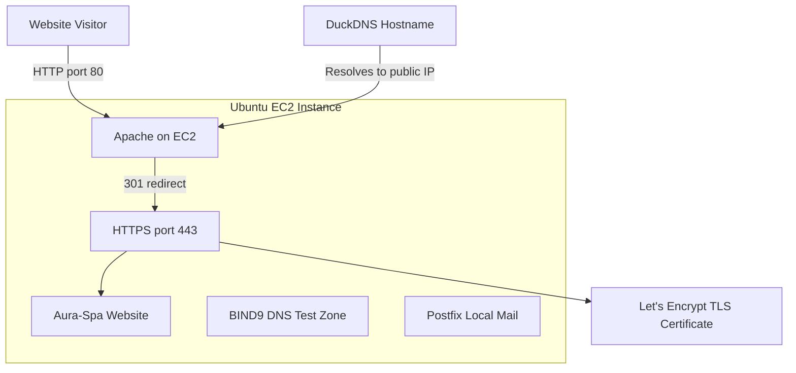

# Aura-Spa: AWS Web Hosting, HTTPS, and Linux Services

## Project Overview

This project demonstrates the deployment and administration of an Ubuntu web server hosted on Amazon EC2. It covers web hosting with Apache, DNS fundamentals with BIND9, local email delivery with Postfix, and HTTPS configuration using Let's Encrypt and Certbot.

The project also documents service validation, HTTP-to-HTTPS redirection, and SSL certificate renewal testing.

## Objectives

- Deploy and manage an Ubuntu server on AWS EC2.
- Host a website using Apache HTTP Server.
- Configure a DuckDNS hostname.
- Enable HTTPS using a Let's Encrypt TLS certificate.
- Redirect HTTP requests to HTTPS.
- Configure a local DNS test zone using BIND9.
- Configure Postfix for local-only email delivery.
- Validate services and test certificate renewal.

## Architecture



BIND9 and Postfix are configured for local testing. They are not exposed as public DNS or public email services.

## Project Documentation

- [Infrastructure Architecture](docs/architecture.md) — components, request flow, and security boundaries.
- [Deployment Guide](docs/deployment-guide.md) — setup steps and verification commands.
- [Troubleshooting Guide](docs/troubleshooting.md) — diagnostic commands and common service issues.
- [Health-Check Script](scripts/health-check.sh) — checks Apache, BIND9, Postfix, and HTTPS availability.

## Live Demo

**Website:** https://aura-spa.duckdns.org

The website is served over HTTPS. HTTP requests redirect to HTTPS.

## Validation Highlights

- Apache service verified as active.
- BIND9 local test-zone lookups verified.
- Postfix local mail delivery verified.
- HTTPS endpoint returned `200 OK`.
- HTTP redirected with `301 Moved Permanently`.
- Certbot renewal dry run succeeded.


## Technologies Used

- Amazon Web Services (AWS EC2)
- Ubuntu Linux
- Apache HTTP Server
- DuckDNS
- Let's Encrypt
- Certbot
- BIND9
- Postfix
- Linux command-line tools
- Git and GitHub

## Implementation Summary

### 1. Web Hosting

Installed and configured Apache on Ubuntu to serve the Aura-Spa website.

### 2. DNS Configuration

Configured the DuckDNS hostname `aura-spa.duckdns.org` to reach the website's public endpoint.

Created a local BIND9 test zone named `lab.test` with sample A, NS, and MX records. The DNS service listens on loopback for local testing.

### 3. HTTPS Configuration

Used Certbot with the Apache integration to obtain and install a Let's Encrypt TLS certificate for the DuckDNS hostname.

Certificate files:

- Full chain: `/etc/letsencrypt/live/aura-spa.duckdns.org/fullchain.pem`
- Private key: `/etc/letsencrypt/live/aura-spa.duckdns.org/privkey.pem`

The private key must never be uploaded to GitHub.

### 4. HTTP-to-HTTPS Redirection

Configured Apache to redirect HTTP requests to HTTPS.

Verified with:

```bash
curl -I http://aura-spa.duckdns.org
```

Expected result:

```text
HTTP/1.1 301 Moved Permanently
Location: https://aura-spa.duckdns.org/
```

### 5. Local Mail Testing

Configured Postfix for local-only mail delivery and verified that a test message was delivered to a local mailbox.

This does not constitute a publicly operational email service.

## Validation and Testing

| Test | Expected or observed result |
|---|---|
| Apache service status | Active |
| BIND9 service status | Active |
| Postfix service status | Running |
| HTTPS request | `200 OK` |
| HTTP request | `301 Moved Permanently` |
| BIND9 local A-record lookup | `127.0.0.1` for `www.lab.test` |
| BIND9 local MX-record lookup | `10 mail.lab.test.` |
| Certbot renewal dry run | Successful |

Commands used for validation:

```bash
sudo apache2ctl configtest
sudo systemctl is-active apache2
sudo systemctl is-active bind9
sudo postfix status

curl -I https://aura-spa.duckdns.org
curl -I http://aura-spa.duckdns.org

dig @127.0.0.1 www.lab.test +short
dig @127.0.0.1 lab.test MX +short

sudo certbot renew --dry-run
```

## Security Considerations

- Keep SSH access restricted to trusted IP addresses.
- Allow inbound HTTP and HTTPS only as required.
- Keep DNS and SMTP ports closed to public access for this local-only configuration.
- Never commit private keys, passwords, access tokens, or AWS credentials.
- Review AWS security groups and resource costs regularly.
- Keep the operating system and installed packages updated.

## Future Improvements

- Automate server setup with Ansible.
- Add a Bash health-check script.
- Configure monitoring and alerting.
- Implement infrastructure provisioning with Terraform.
- Add a deployment workflow using GitHub Actions.
- Document backup and recovery procedures.

## Live Website

[https://aura-spa.duckdns.org](https://aura-spa.duckdns.org)

## Skills Demonstrated

AWS infrastructure basics, Linux system administration, web server configuration, DNS fundamentals, TLS certificates, HTTPS redirection, mail-server fundamentals, troubleshooting, and service validation.
